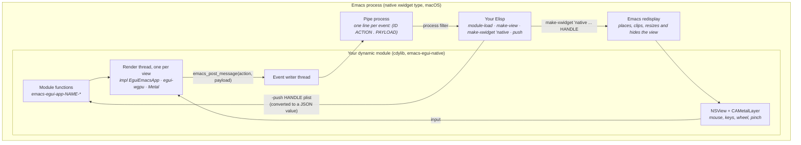
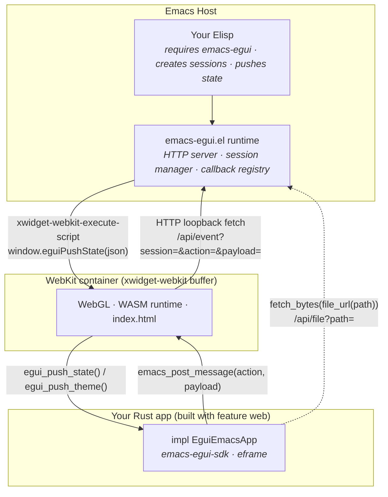

# emacs-egui

[](https://www.rust-lang.org/)
[](https://www.gnu.org/software/emacs/)
[](LICENSE)

emacs-egui is a framework for [egui](https://github.com/emilk/egui) applications that run inside Emacs: an application implements one SDK trait, and either of two backends hosts it. The **native** backend links the application into an Emacs dynamic module that draws with [wgpu](https://github.com/gfx-rs/wgpu) on Metal into a view Emacs places in a buffer; it is the one to use for egui content, because a view shows its first frame about 10 ms after it is created (measured in a 320 × 200 card), runs with no helper process, and uses no CPU while nothing changes. The **web** backend compiles the same application to WebAssembly and shows it in an `xwidget-webkit` page; it is the one to use for content whose value is the web engine itself, and on an Emacs without the patch the native backend needs.

Platforms: the native backend is macOS only (Apple silicon) and needs Emacs's `native` xwidget type, which comes from a [bendmacs-emacs](https://github.com/nohzafk/bendmacs-emacs) release (`emacs-31.1-bendmacs.2` or later) or from that repository's `patches/emacs-31/native-xwidget.patch` applied to your own build. The web backend needs Emacs 29.1 or later built with xwidgets.

**emacs-egui is not an Emacs package you install and use directly.** It is the SDK and runtime that an application is built on; end users install the application.

## Apps built with emacs-egui

| App | Backend | Description |
|-----|---------|-------------|
| [emacs-parquet-explorer](https://github.com/nohzafk/emacs-parquet-explorer) | web | GPU-accelerated Parquet file viewer with virtual scrolling, search, filtering, and CSV export |
| [emacs-workspace-hud](https://github.com/nohzafk/emacs-workspace-hud) | web | A floating workspace status HUD for Emacs, showing Git, LSP, and diagnostic state in an egui card |

---

## How it works

### Native backend



### Web backend



### The parts

| Part | What it is |
|------|------------|
| `sdk/` (`emacs-egui-sdk`) | What an application is written against, whichever backend hosts it: the `EguiEmacsApp` trait, `ThemeColors`, and `emacs_post_message`. Emacs pushes state as a plist (native) or JSON (web); both arrive as one `serde_json::Value` and are deserialized into the application's `State` type, and a state that does not fit is an error that names where, as `sections[0].priority`. A theme (`:bg`, `:fg`, `:font-size`, `:surface-bg`, `:font-family`) is mapped onto egui's style before `on_theme_update` is called. The cargo feature `web` adds the eframe bootstrap (`launch`, `launch_simple`), the JavaScript entry points `egui_push_state` and `egui_push_theme`, and the loopback helpers `file_url` and `fetch_bytes`. The SDK re-exports `egui`, `serde` and `serde_json`. |
| `native/` (`emacs-egui-native`) | The native runtime, a library an application module links. `export_app!` makes the application crate an Emacs module whose functions are named `emacs-egui-app-NAME-…` (see [API reference](#native-module-functions)). Each view is an `NSView` backed by a `CAMetalLayer`, placed by Emacs through `make-xwidget 'native`; a render thread per view draws only when there is input, a push, a resize, an unhide or a repaint egui asked for, and not at all while the view is hidden. Events reach Elisp as lines on a pipe process. Keys go to Emacs unless the view is focused; `C-g` always reaches Emacs and unfocuses the view. A click reaches egui and also selects the Emacs window the view is in. The wheel and the trackpad pinch scroll and zoom the buffer, unless the application calls `current::set_takes_wheel(true)`, after which egui receives them. A Rust panic in a module function reaches Lisp as the `rust-panic` signal with its message and location; a panic on a render thread becomes an `error` event. |
| `raster/` (`emacs-egui-raster`) | A separate dynamic module that renders SVG to PNG with [resvg](https://github.com/linebender/resvg), so Emacs shows the same image whichever SVG engine it was built with (AppKit's, without librsvg, has no markers and ignores `dy` on text rows). `emacs-egui-raster-svg` returns PNG bytes, `emacs-egui-raster-svg-size` the SVG's own size, `emacs-egui-raster-fonts` what the shared font database loaded. Independent of the SDK; it builds on its own. |
| `lisp/emacs-egui.el` | The web backend's Elisp runtime: a loopback HTTP server for the application's assets, local files and events, the xwidget-webkit sessions, theme sync, and the callback registry. The native backend needs no Elisp runtime: the module's own functions and a pipe process are the whole interface. |

---

## Building an app

The walkthrough builds one crate, `my-emacs-app`, for both backends.

### Layout

```text
my-emacs-app/
├── emacs-egui/              # git submodule
├── ui/                      # the application crate
│   ├── Cargo.toml
│   ├── src/lib.rs           # impl EguiEmacsApp, both entry points
│   ├── index.html           # web: the page that loads the WASM bundle
│   └── pkg/                 # web: wasm-pack output
└── lisp/
    └── my-emacs-app.el
```

```sh
git submodule add https://github.com/nohzafk/emacs-egui.git emacs-egui
```

### `ui/Cargo.toml`

```toml
[package]
name = "my-emacs-app"
version = "0.1.0"
edition = "2021"

[lib]
crate-type = ["cdylib"]

[features]
web = ["emacs-egui-sdk/web", "dep:wasm-bindgen"]
native = ["dep:emacs-egui-native"]

[dependencies]
emacs-egui-sdk = { path = "../emacs-egui/sdk" }
emacs-egui-native = { path = "../emacs-egui/native", optional = true }
serde = { version = "1.0", features = ["derive"] }
wasm-bindgen = { version = "0.2", optional = true }
```

### `ui/src/lib.rs`

```rust
use emacs_egui_sdk::{egui, emacs_post_message, serde_json::json, EguiEmacsApp, ThemeColors};
use serde::Deserialize;

/// What Emacs pushes: the plist (:username "World" :counter 0).
#[derive(Deserialize, Default)]
pub struct State {
    #[serde(default)]
    username: String,
    #[serde(default)]
    counter: i64,
}

#[derive(Default)]
pub struct MyApp {
    state: State,
}

impl EguiEmacsApp for MyApp {
    type State = State;

    fn on_state_update(&mut self, state: State) {
        self.state = state;
    }

    fn on_theme_update(&mut self, _theme: ThemeColors) {
        // The SDK has already applied the theme to the context's style.
    }

    fn update(&mut self, ui: &mut egui::Ui) {
        // The root Ui has no background of its own.
        ui.painter()
            .rect_filled(ui.max_rect(), 0.0, ui.visuals().panel_fill);
        egui::Frame::NONE
            .inner_margin(egui::Margin::same(10))
            .show(ui, |ui| {
                ui.heading(format!("Hello, {}", self.state.username));
                if ui.button(format!("Count: {}", self.state.counter)).clicked() {
                    self.state.counter += 1;
                    emacs_post_message("incremented", json!({ "count": self.state.counter }));
                }
            });
    }
}

#[cfg(feature = "web")]
#[wasm_bindgen::prelude::wasm_bindgen]
pub fn start_app(canvas_id: &str) -> Result<(), wasm_bindgen::JsValue> {
    emacs_egui_sdk::launch_simple(canvas_id, MyApp::default())
}

#[cfg(feature = "native")]
emacs_egui_native::export_app!(MyApp, "my-app");
```

`export_app!(MyApp, "my-app")` makes a new `MyApp::default()` for each view and names the module's functions and feature `emacs-egui-app-my-app`.

### Build

```sh
# native: ui/target/aarch64-apple-darwin/release/libmy_emacs_app.dylib
cd ui && cargo build --release --target aarch64-apple-darwin --features native

# web: ui/pkg/
wasm-pack build ui --target web --release --out-dir pkg -- --features web
```

The native build needs Rust's `aarch64-apple-darwin` target; the web build needs `wasm32-unknown-unknown` and [wasm-pack](https://github.com/rustwasm/wasm-pack).

### Elisp, native backend

The module is loaded once. Every view of it writes its events to one pipe process, one line `(ID ACTION . PAYLOAD)` per event, where ACTION is a symbol and PAYLOAD a plist.

```elisp
;;; -*- lexical-binding: t; -*-
(defconst my-app--module
  (expand-file-name
   "../ui/target/aarch64-apple-darwin/release/libmy_emacs_app.dylib"
   (file-name-directory (or load-file-name buffer-file-name))))

(unless (featurep 'emacs-egui-app-my-app)
  (module-load my-app--module))

(defun my-app--event (_id action payload)
  "Handle one event of a view: ACTION is a symbol, PAYLOAD a plist."
  (pcase action
    ('incremented (message "Count is now %d" (plist-get payload :count)))
    ('error (message "my-app: %s" (plist-get payload :message)))))

(defvar my-app--channel
  (let ((pending ""))
    (make-pipe-process
     :name " *my-app events*" :buffer nil :coding 'utf-8 :noquery t
     :filter (lambda (_proc string)
               (setq pending (concat pending string))
               (let (nl)
                 (while (setq nl (string-search "\n" pending))
                   (let ((line (substring pending 0 nl)))
                     (setq pending (substring pending (1+ nl)))
                     (pcase-let ((`(,id ,action . ,payload) (read line)))
                       (my-app--event id action payload))))))))
  "The pipe process the module writes every view's events to.")
(emacs-egui-app-my-app-open-channel my-app--channel)

(defun my-app--hex (color)
  (apply #'format "#%02x%02x%02x"
         (mapcar (lambda (v) (/ v 257)) (color-values color))))

(defun my-app-open ()
  "Show My App in a buffer."
  (interactive)
  (let* ((buf (get-buffer-create "*My App*"))
         (theme (list :bg (my-app--hex (face-background 'default nil t))
                      :fg (my-app--hex (face-foreground 'default nil t))))
         (handle (emacs-egui-app-my-app-make-view 320 200 theme))
         (xw (make-xwidget 'native "my-app" 320 200 handle buf)))
    (set-xwidget-query-on-exit-flag xw nil)
    (with-current-buffer buf
      (erase-buffer)
      (insert (propertize " " 'display (list 'xwidget :xwidget xw)))
      (add-hook 'kill-buffer-hook
                (lambda () (emacs-egui-app-my-app-release handle)) nil t))
    (emacs-egui-app-my-app-push handle '(:username "World" :counter 0))
    (pop-to-buffer buf)))
```

A push made before the view's first frame is kept and shown in that frame. Where the states are messages rather than a snapshot (a feed of events), `-send` keeps every one and `on_state_update` is called once per message, in order, before the frame. `(emacs-egui-app-my-app-focus handle)` gives the view the keyboard; `C-g` gives it back.

### Elisp, web backend

The web backend also needs `ui/index.html`, the page that loads the bundle and binds the entry points the runtime calls:

```html
<!DOCTYPE html>
<html lang="en">
<head>
    <meta charset="utf-8">
    <title>my-emacs-app</title>
    <style>
        html, body { margin: 0; padding: 0; width: 100%; height: 100%;
                     overflow: hidden; background-color: transparent; }
        canvas { width: 100%; height: 100%; display: block;
                 background-color: transparent; opacity: 0;
                 transition: opacity 80ms ease-out; }
        canvas.ready { opacity: 1; }
    </style>
</head>
<body>
    <canvas id="egui-canvas"></canvas>
    <script type="module">
        import init, { start_app, egui_push_state, egui_push_theme }
            from "./pkg/my_emacs_app.js";

        async function run() {
            const canvas = document.getElementById("egui-canvas");
            await init();
            await start_app("egui-canvas");

            // The runtime puts the theme in the URL fragment, so the first
            // frame is already in the Emacs theme.
            const p = new URLSearchParams(window.location.hash.replace(/^#/, ""));
            if (p.get("bg") && p.get("fg")) {
                egui_push_theme(JSON.stringify({
                    bg: p.get("bg"), fg: p.get("fg"),
                    "font-size": p.get("font-size") ? Number(p.get("font-size")) : null,
                }));
            }
            requestAnimationFrame(() => canvas.classList.add("ready"));

            window.eguiPushState = (json) => { egui_push_state(json); };
            window.eguiPushTheme = (json) => { egui_push_theme(json); };
        }
        run();
    </script>
</body>
</html>
```

```elisp
;;; -*- lexical-binding: t; -*-
(require 'emacs-egui)   ; emacs-egui/lisp on load-path, see Distribution

(emacs-egui-register-app
 "my-emacs-app"
 (expand-file-name "../ui/" (file-name-directory (or load-file-name buffer-file-name))))

(defun my-app-open-web ()
  "Show My App in an xwidget-webkit buffer."
  (interactive)
  (let ((session (emacs-egui-create-buffer :app-name "my-emacs-app"
                                           :buffer-name "*My App*")))
    ;; The page posts `ready' after its first frame; a push before that is lost.
    (emacs-egui-on session "ready"
                   (lambda (_payload)
                     (emacs-egui-send-state session '(:username "World" :counter 0))))
    (emacs-egui-on session "incremented"
                   (lambda (payload)
                     (message "Count is now %d" (emacs-egui-get-field payload 'count))))
    (switch-to-buffer (plist-get session :buffer))))
```

---

## API reference

### Rust: `emacs-egui-sdk`

```rust
pub trait EguiEmacsApp {
    type State: serde::de::DeserializeOwned;
    fn on_state_update(&mut self, state: Self::State);
    fn on_theme_update(&mut self, theme: ThemeColors);
    fn update(&mut self, ui: &mut egui::Ui);
}
```

| Item | Description |
|------|-------------|
| `update(ui)` | Draw one frame into the root `Ui`, which covers the whole widget with no margin or background; its context is `ui.ctx()`. |
| `on_state_update(state)` | Called with each pushed state, before the frame that shows it. |
| `on_theme_update(theme)` | Called after the SDK has applied a pushed theme to the context's style. |
| `ThemeColors` | `bg`, `fg`, `surface_bg` (hex strings), `font_size: Option<f32>`, `font_family: Option<String>`. |
| `emacs_post_message(action, payload)` | Send ACTION with a serializable payload to Emacs, from inside `update`. |
| `apply_theme_to_ctx(ctx, theme)`, `parse_hex_color(hex)` | The theme mapping the SDK applies, for an application that wants it elsewhere. |
| `launch_simple(canvas_id, app)` | *web*: start eframe on the canvas; call it from the `#[wasm_bindgen]` entry point. |
| `launch(canvas_id, \|params\| App::new(params))` | *web*: the same, passing `SessionParams` (session id and server port) to the constructor. |
| `file_url(path)`, `fetch_bytes(url)` | *web*: fetch a local file through the runtime's `/api/file` route. |

Both backends post `ready` after the first frame and `painted` after a frame that showed a push or a theme. A pushed state that does not fit `State` is an `error` event (`:message`) on the web backend; on the native backend `-push` signals the error itself.

### Rust: `emacs-egui-native`

| Item | Description |
|------|-------------|
| `export_app!(App, "name")` | Export the crate as a module with functions and feature `emacs-egui-app-name`, a new `App::default()` per view. |
| `export_app!(App, "name", ctor)` | The same, a new `ctor()` per view. |
| `export_app!(App, prefix = "p", ctor)` | A function prefix of your own; `class = "Name"` after `ctor` also names the Objective-C view class. |
| `current::set_takes_wheel(bool)` | From `update`: whether the wheel and pinch go to egui rather than the buffer. |
| `current::focused()`, `current::id()` | From `update`: whether the view has the keyboard; its numeric id. |
| `current::set_info(key, value)` | From `update`: show VALUE as `:KEY` in `-info`. |
| `current::repaint_handle()` | From `update`: a `Send + Sync` handle whose `request_repaint()` asks the view for a frame from any thread, for an application fed by its own reader thread. It does not keep the view alive. |

### Elisp: native module functions

Each is named after the module's prefix, here `emacs-egui-app-my-app`.

| Function | Description |
|----------|-------------|
| `(-open-channel PROC)` | Send every view's events to the pipe process PROC. |
| `(-make-view W H &optional THEME)` | Make a view of W × H points running a new instance of the application; THEME is a plist (`:bg :fg :font-size :font-family`) applied before the first frame. Returns the handle for `(make-xwidget 'native TITLE W H HANDLE BUFFER)`. |
| `(-push HANDLE STATE)` | Hand STATE, a plist, to the application; an error if it does not deserialize into `State`. A state not drawn yet, pushed or sent, is superseded: a push is the latest state. |
| `(-send HANDLE STATE)` | Queue STATE behind what is not drawn yet; the next frame hands the application every queued state in order, so a stream of messages loses none. The queue grows while the view is hidden and draws no frame. |
| `(-push-theme HANDLE THEME)` | Hand a new theme to the view. |
| `(-focus HANDLE)`, `(-unfocus HANDLE)` | Give the view the keyboard (all keys but `C-g`), or give it back to Emacs. |
| `(-release HANDLE)` | Stop the view's render thread and drop the module's reference; the xwidget keeps its own until it is killed. Releasing twice does nothing. |
| `(-id HANDLE)`, `(-frames HANDLE)`, `(-info HANDLE)` | The view's id (the first element of its event lines), its frame count, and a plist describing it. |
| `-panic`, `-test-*` | Test entries: a deliberate panic; posted clicks, mouse events, keys, pinches and scrolls; counters. |

The module's own events are `ready`, `painted`, `hidden`, `shown`, `paused`, `resumed`, `frames`, `unfocus`, `released` and `error`; the application's come from `emacs_post_message`. A pushed plist becomes a JSON object keyed by the keywords' names without the colon; another list or a vector becomes an array (so a list of plists is an array of objects), `t` is `true`, `nil` is `null` and `:json-false` is `false`. A value with no JSON form is an error that names where it is.

### Elisp: `emacs-egui-raster`

| Function | Description |
|----------|-------------|
| `(emacs-egui-raster-svg SVG &key WIDTH HEIGHT SCALE DEFAULT-FONT)` | Render SVG to PNG and return it as a unibyte string. WIDTH and HEIGHT are the box in points the image is fitted into, SCALE the device pixels per point, DEFAULT-FONT the family of text that names none. Signals `emacs-egui-raster-error` on SVG it cannot parse. |
| `(emacs-egui-raster-svg-size SVG)` | The SVG's own size in points, `(WIDTH . HEIGHT)`. |
| `(emacs-egui-raster-fonts &optional FAMILIES)` | What the font database loaded (`:faces`, `:load-ms`) and the face each generic family, and each name in FAMILIES, resolves to. |

### Elisp: `emacs-egui.el` (web)

| Function | Description |
|----------|-------------|
| `(emacs-egui-register-app NAME UI-DIR)` | Register an application's UI directory; call it at load time. |
| `(emacs-egui-create-buffer :app-name NAME :buffer-name BUF)` | Create an xwidget-webkit session; returns a plist with `:id`, `:buffer`, `:xwidget`, `:app-name`. |
| `(emacs-egui-on SESSION ACTION CALLBACK)` | Call CALLBACK with the payload of each ACTION the page posts. |
| `(emacs-egui-send-state SESSION STATE)` | Push STATE, an alist or plist, as JSON. It is encoded with `json-encode`, which reads a list of plists as an alist. |
| `(emacs-egui-send-theme SESSION)` | Push the default face's colours on the session's frame. |
| `(emacs-egui-get-field PAYLOAD KEY)` | A field of a callback payload, whether alist or plist. |
| `(emacs-egui-ensure-server)` | Start the loopback HTTP server; `emacs-egui-create-buffer` calls it. |
| `(emacs-egui-shutdown)` | Kill the server and forget every session. |

---

## Distribution

An application includes emacs-egui as a git submodule at its root. `sdk/` and `native/` are path dependencies of the application crate, and the web runtime is required from `emacs-egui/lisp/`.

```text
my-app/
├── emacs-egui/                  # git submodule
│   ├── sdk/                     # path dependency
│   ├── native/                  # path dependency (feature native)
│   └── lisp/emacs-egui.el       # web runtime
├── ui/
│   ├── Cargo.toml
│   ├── src/lib.rs
│   ├── index.html
│   └── pkg/                     # prebuilt web bundle, committed
└── lisp/
    └── my-app.el
```

The application ships what it builds: the `pkg/` bundle for the web backend, and the prebuilt `.dylib` for the native one, so a user needs no Rust toolchain. Users clone with `--recurse-submodules` and add the application's `lisp/` to `load-path`.

The Elisp side finds the bundled runtime when no other copy is on `load-path`:

```elisp
(eval-and-compile
  (unless (or (featurep 'emacs-egui) (locate-library "emacs-egui"))
    (add-to-list 'load-path
                 (expand-file-name "../emacs-egui/lisp/"
                                   (file-name-directory
                                    (or load-file-name
                                        (bound-and-true-p byte-compile-current-file)
                                        buffer-file-name)))))
  (require 'emacs-egui))
```

emacs-egui is not on a package archive, so leave it out of `Package-Requires`. `(require 'emacs-egui)` is idempotent: when several applications bundle it, the first one loaded provides it, and `emacs-egui-version` gates on a minimum version. `git submodule update --remote emacs-egui` takes framework updates.

---

## License

MIT
